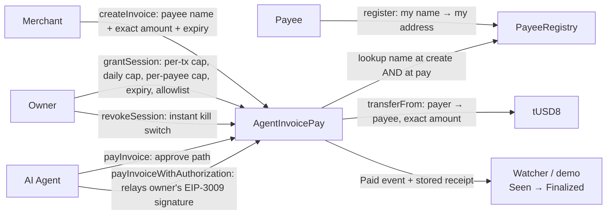

# PaySure Agent

**An AI agent that pays invoices on Aevum — but only the named, verified payee, only the exact amount, and only inside a contract-enforced session budget.**

Built for the **Aevum Builder Challenge #1** (QDay.io / PQA Labs, on DoraHacks) — one
end-to-end tUSD8 payment flow on the Aevum testnet (chain **44005**).

🔴 **Live demo (reads chain 44005 live in your browser; the “Try it live” panel
writes on-chain through your own wallet):**
https://ajengayukusu.github.io/paysure-agent/

🎥 **Demo video (2:46):** https://www.youtube.com/watch?v=DI32ZnA-iVk

---

## The problem

Letting an AI agent hold a wallet key means letting it spend without limits, to any
address it — or a prompt injection — chooses. Two failure stories repeat in agent payments:

1. **Wrong recipient.** Address poisoning or a hallucinated address sends funds to a
   lookalike. A raw ERC-20 `Transfer` carries no payee name, so nothing checks *who* was meant.
2. **Runaway or mispriced spend.** A generic checkout records *any* amount as "paid"
   (the Aevum Starter Kit's own docs warn that its example lets `pay(orderId, 1)` settle
   an order for 0.000001 tUSD8), and there are no caps if an agent key leaks or loops.

PaySure answers both **on-chain**, not with UI promises.

## What it does — 4 features

1. **Confirmation of Payee registry** (`PayeeRegistry`). A case-insensitive
   name → address registry that lives in its own contract (QDay's ERC-8004 registry is
   not open for this challenge, so the mapping is kept here, exactly as the starter-kit
   docs prescribe). A payee self-registers its own name; a registered name can never be
   overwritten by someone else. The registry is checked when an invoice is created
   **and re-checked when it is paid** — if the mapping changed, payment is blocked
   instead of paying a stale address.
2. **Session-budgeted agent** (`AgentInvoicePay`). The owner grants an agent a *session*:
   per-transaction cap, daily cap (UTC-day window), **per-payee cap** (max total to one
   payee per day — added in v2, 21 Nov 2026), session expiry, and a per-payee
   allowlist — all enforced in the contract, with an instant one-transaction revoke.
   Every payment must equal the invoice amount **exactly** (under- *and* over-payment
   revert), which fixes the starter kit's documented missing amount check.
3. **Gasless payment via EIP-3009.** The owner signs a `ReceiveWithAuthorization`
   off-chain (nonce bound to the invoice's orderId, the kit's pattern); the agent
   relays it and pays the gas. The payer sends no transaction and needs no tQDAY
   for the payment itself.
4. **Provable receipts, Seen → Finalized.** Every payment stores an on-chain receipt
   (payer, agent, payee, amount, timestamp) and emits a `Paid` event. The watcher
   script (and the live demo) scans `Paid` events from the deploy block in chunks of
   ≤ 1,000 blocks (the Aevum RPC limit), deduplicates by `txHash:logIndex`, skips
   zero-value events, and reports each receipt as **Seen** until its block is at or
   below the chain's `finalized` block, then **Finalized**.

Funds always move **payer → payee**; the contract never holds a balance.

## Live demo

**https://ajengayukusu.github.io/paysure-agent/** — a static page (in `demo/`) that
reads everything live from the Aevum RPC with plain JSON-RPC, no libraries: payee
lookup against the registry, the evidence invoices (v1 + v2) with live state, the
agent session and its caps (including the per-payee cap and today's spend to the
payee), live balances, and the receipts watcher merging both contracts. Every
number on the page is a chain read, not a screenshot.

The demo also has a **“Try it live” write panel**: connect your own Web3 wallet
(EIP-1193, e.g. MetaMask) and the page builds calldata locally for real on-chain
writes — **register your payee name** in the registry, **create an invoice** as a
merchant, and **pay an invoice** (enabled only when the connected wallet holds an
active agent session). It also includes **owner session management**: the contract
owner's wallet can **grant or revoke agent sessions** (per-tx / daily / per-payee
caps + expiry) and **set the per-session payee allowlist** from the same panel —
every other wallet sees those controls disabled. The page never holds a key; your wallet signs everything,
and every write is pre-flighted with `eth_call` so a contract revert is explained
in plain words before you sign.

## Architecture



| Component | Role |
|---|---|
| `src/PayeeRegistry.sol` | Confirmation of Payee: case-insensitive name → address, self-registration, no overwriting, events on every change. A reusable primitive for any Aevum payment app. |
| `src/AgentInvoicePay.sol` | Invoices (exact amount + expiry), agent sessions (per-tx / daily / per-payee caps, expiry, allowlist, revoke), both payment paths, on-chain receipts, merchant refund bookkeeping. |
| `src/mocks/MockTUSD8.sol` | Local test token (6 decimals, EIP-712 domain `("tUSD8","2")`, full EIP-3009), adapted from the starter kit's `MockUSD8`. Local testing only. |
| `scripts/watch-receipts.mjs` | Dependency-free receipts watcher: chunked `eth_getLogs` over **both** AgentInvoicePay contracts (v1 + v2, merged), dedupe, Seen → Finalized, writes `scripts/receipts.json`. |
| `scripts/pay-gasless-live.mjs` | The v1 live gasless flow: owner signs EIP-3009 off-chain, agent relays. Reads test-wallet keys at runtime from `~/workspace/aevum-challenge/.wallet/` (outside this repo; keys are never committed). |
| `scripts/deploy-and-prove-v2.mjs` | The v2 deploy + live proofs: deploys AgentInvoicePay v2 against the existing registry, grants the per-payee-cap session, pays invoice A, proves invoice B's `PerPayeeCapExceeded` revert by simulation, pays invoice C gasless. Idempotent; same key handling as above. |
| `demo/` | Static live demo (the GitHub Pages site above) — live reads plus a wallet write panel. `demo/test-rpc.mjs` is a headless harness asserting the same reads against known on-chain truth (44 checks). |

A payment succeeds **only if all** hold — otherwise it reverts with a specific error:
invoice exists · not already paid · not expired · amount equals the invoice amount
exactly · registry still resolves the invoice's payee name to the invoice's payee ·
session granted, not revoked, not expired · payee allowlisted · amount ≤ per-tx cap ·
spent-today + amount ≤ daily cap · spent-to-this-payee-today + amount ≤ per-payee cap
(when the per-payee cap is enabled).

## Contracts on Aevum testnet (chain 44005)

Explorer: https://explorer-test.qday.info · Full details in [`deployments.md`](deployments.md).
(Explorer source verification is not available on Aevum yet — addresses + this repo
are the proof, per the starter-kit docs.)

| Contract | Address |
|---|---|
| PayeeRegistry | [`0x4A31fD9169E2DFaBB0763c1E8B38B24eC516780A`](https://explorer-test.qday.info/address/0x4A31fD9169E2DFaBB0763c1E8B38B24eC516780A) |
| **AgentInvoicePay v2 (current)** | [`0xeEBa81989B929F21354851a0F00F92239f5faCC8`](https://explorer-test.qday.info/address/0xeEBa81989B929F21354851a0F00F92239f5faCC8) |
| AgentInvoicePay v1 (superseded) | [`0x2D0ff19258d19d38F6352E8F565dF0BC3F7054ed`](https://explorer-test.qday.info/address/0x2D0ff19258d19d38F6352E8F565dF0BC3F7054ed) |
| tUSD8 (QDay) | [`0x456569838f1d43009A91ebA4263147Afd7233483`](https://explorer-test.qday.info/address/0x456569838f1d43009A91ebA4263147Afd7233483) |

## v2 upgrade — 21 Nov 2026: the per-payee cap

**What changed.** Sessions gained a fourth budget dimension: a **per-payee cap** —
the maximum total a session may pay to *one* payee per UTC day, tracked per
(session agent, payee, day) and enforced on **both** payment paths (approve and
gasless EIP-3009). It closes a hole the other caps leave open: per-tx and daily
caps limit speed and total volume, but without a per-payee cap an agent could
still route its whole daily budget to a single wrong-but-allowlisted recipient.
`grantSession` takes the new cap (`perPayeeCap == 0` disables the check), the
contract tracks it in a public getter (`spentToPayeeToday(agent, payee)`), and a
crossing payment reverts with `PerPayeeCapExceeded(amount, spentToPayeeToday, cap)`.
Everything else is unchanged, and the **registry was not redeployed** — v2 is
wired to the same PayeeRegistry, so "Sari Bakery" and every other registration
carried over. The live demo (above) now reads v2, shows the per-payee cap and
today's spend to the payee, and gained a wallet write panel.

**Live evidence on v2** (session: per-tx 2 · daily 3 · **per-payee 1.50 tUSD8/day**):

| Step | Result | Transaction |
|---|---|---|
| AgentInvoicePay v2 deployed | block 3,739,911, wired to tUSD8 + the existing registry | [`0x8c4d7b31…fd7`](https://explorer-test.qday.info/tx/0x8c4d7b31d456993532e9e63021dbf37bf7c852b215c4068f4c8ba89c5b3e4fd7) |
| Session granted with per-payee cap | per-payee cap 1.50 tUSD8/day, payee allowlisted | [`0xccc67b32…7f19`](https://explorer-test.qday.info/tx/0xccc67b32768a459d6488dfa9cbe121b22584ac4e60fbc257dbcad0a500997f19) · [`0xacc6ed3a…4599`](https://explorer-test.qday.info/tx/0xacc6ed3a9c8323ba670948d723920c48997a09f17936d4fa3d49af2ec8604599) |
| **Invoice A paid — 1.25 tUSD8** (agent, approve path) | payee 2.00 → 3.25; receipt stored on-chain | [`0x7861a801…c30`](https://explorer-test.qday.info/tx/0x7861a801e12cd58fe6e653a1a7c80f536a02a7e972a0325cb8719e2cdc9b8c30) |
| **Invoice B — 0.75 tUSD8 payment refused** | simulation reverts `PerPayeeCapExceeded(750000, 1250000, 1500000)`: 1.25 already paid today + 0.75 > 1.50 cap. Proved by `eth_call` simulation (no failing tx broadcast); invoice verified still unpaid | invoice created in [`0xdeef370e…8e2b`](https://explorer-test.qday.info/tx/0xdeef370efba630d7318886d47cab6cd4ca24266f9089d638a150491422658e2b) |
| **Invoice C paid gasless — 0.25 tUSD8** (owner signed off-chain, agent relayed) | payee 3.25 → **3.50**, owner 1.75 → **1.50**; cumulative to the payee today = exactly 1.50 — at the cap, so the cap composes with the gasless path | [`0xaa5569bf…29f`](https://explorer-test.qday.info/tx/0xaa5569bf11c08481c3a486c13e26e36d2e6080786bb82f24dcf1222c8c76829f) |

Final v2 state, read back on-chain: `spentToPayeeToday(agent, payee)` = **1.50 tUSD8**
(= the cap), session spent-today = 1.50, payee total balance **3.50 tUSD8**
(2.00 from v1 + 1.50 from v2), owner **1.50 tUSD8**.

## Evidence — v1 (20 Nov 2026, superseded contract)

🎥 **Demo video (v1):** [PaySure Agent — Agent Invoice Payments on Aevum (QDay Testnet)](https://www.youtube.com/watch?v=w3RB_iAIHEs) (2:32) — a live recording of the v1 demo page walking through the on-chain evidence below.

| Step | Result | Transaction |
|---|---|---|
| Payee "Sari Bakery" self-registers | `lookup` returns the payee address, case-insensitive | [`0x903c0255…3823a`](https://explorer-test.qday.info/tx/0x903c02550a9950344cd950ece6a6f180fd96cf4f09bd435a13c747a60833823a) |
| Session granted to agent | per-tx cap 2 tUSD8 · daily cap 3 tUSD8 · payee allowlisted | [`0x761f728c…ae62`](https://explorer-test.qday.info/tx/0x761f728ccaa9a27e450295f8cd96e67a2784da85c91a9daf3ff32315c6f2ae62) · [`0xf331d267…050d`](https://explorer-test.qday.info/tx/0xf331d2677e879c543787131b62d97f5df14981a902f423ba1ae4d46199b0050d) |
| **Invoice #1 paid — 1.25 tUSD8** (agent, approve path) | payee balance 0 → 1.25 exactly; receipt stored on-chain | [`0x0640f8f0…ad79`](https://explorer-test.qday.info/tx/0x0640f8f00d77e4d3fadc850c71afc2ad44aea9d77549ad61185b77c90528ad79) |
| **Invoice #2 — 2.5 tUSD8 payment refused** | reverts `PerTxCapExceeded(2500000, 2000000)`; invoice verified still unpaid, payee balance unchanged | invoice created in [`0x4f64c11b…598`](https://explorer-test.qday.info/tx/0x4f64c11b9ab04ba9759103d6995f2795597045a8c6ced0fe6c1586b9404af598) |
| **Invoice #3 paid gasless — 0.75 tUSD8** (owner signed off-chain, agent relayed) | payee 1.25 → 2.00, owner 3.75 → 3.00, nonce consumed (no replay), owner paid no gas for the payment | [`0xf8340950…ccc0`](https://explorer-test.qday.info/tx/0xf8340950dc7531b55b01de75f81ff3f70372d303f7f4e07c95badeec58d9ccc0) |

## Run it yourself

Prerequisites: **Node 22+**, **Foundry** (`forge`/`cast`), **pnpm** (only for the kit
tooling; the watcher itself is dependency-free). Aevum runs the **Shanghai** EVM —
`foundry.toml` pins `evm_version = "shanghai"`; never raise it to Cancun.

```bash
git clone https://github.com/Ajengayukusu/paysure-agent.git
cd paysure-agent

# Dependencies are pinned and not vendored:
forge install foundry-rs/forge-std@v1.9.6
forge install OpenZeppelin/openzeppelin-contracts@v5.1.0

forge build
node tools/check-shanghai.mjs out   # bytecode must be Shanghai-safe

# Unit tests — 42 tests, all passing (every rejection rule above is covered,
# including 7 per-payee-cap tests: under cap, cumulative crossing, exact cap,
# per-payee isolation, next-day reset, gasless enforcement, cap disabled)
forge test --no-match-path 'test/fork/*'

# Fork tests against the REAL tUSD8 on a local fork of Aevum — 3 tests
forge test --match-path 'test/fork/*' --fork-url aevum --evm-version shanghai

# Receipts watcher (dependency-free) — scans Paid events from both contracts'
# deploy blocks (v1 + v2, merged) in ≤1,000-block chunks, writes receipts.json
node scripts/watch-receipts.mjs

# Live demo locally (same files as the Pages site)
python3 -m http.server 8000 --directory demo
# → http://localhost:8000
```

The gasless live script (`scripts/pay-gasless-live.mjs`, needs `npm install` inside
`scripts/` for viem) is written against the author's local test wallets and reads
their keys from `~/workspace/aevum-challenge/.wallet/` at runtime — it documents
exactly how the v1 invoice #3 evidence above was produced; the *flow* it demonstrates
(simulation → owner signature → agent relay) is fully covered locally by the
`payInvoiceWithAuthorization` unit tests. The v2 evidence was produced the same
way by `scripts/deploy-and-prove-v2.mjs` (deploy + session + all three proofs in
one idempotent run).

## Security & controls

- **Least privilege by construction:** an agent key can only pay allowlisted,
  registry-verified payees, exact invoice amounts, inside per-tx, daily and
  per-payee caps, until session expiry — and the owner can revoke the session
  in one transaction.
- **No custodial balance:** funds move payer → payee atomically; the contract holds nothing.
- **Replay-proof gasless path:** the EIP-3009 nonce is bound to the orderId
  (`keccak256(abi.encode(contract, orderId))`) and `receiveWithAuthorization`
  ensures only this contract can pull the signed funds.
- **Auditability:** invoices, sessions, payments, and refunds are all stored state
  plus events — the full trail is reconstructable from the chain alone.
- **Testnet hygiene:** all keys in the evidence flows are throwaway test wallets;
  no key material exists in this repository.

## Limitations (honest list)

- Refunds are *bookkeeping*: the merchant records the refund transfer's reference;
  the refund itself is a normal token transfer — there is no escrowed refund path yet.
- The daily cap uses a UTC calendar-day window, not a rolling 24 h window.
- The per-payee cap (v2) uses the same UTC calendar-day window as the daily
  cap — it is a per-day limit per payee, not a lifetime or rolling window.
- The gasless path is relayed by the agent (session holder); a third-party relayer
  mode (relayer ≠ agent) is designed but not implemented.
- The local mock has no EIP-2612 `permit` (same as the kit mock); no flow uses permit.
- Aevum finality lagged several thousand blocks during testing, so receipts stay
  "Seen" for a while before flipping to "Finalized" — the demo shows this honestly
  instead of pretending instant finality.

## Roadmap to mainnet

1. Third-party relayer mode + relayer rails (per-order price binding, rate limits)
   carried over from the starter kit's relayer design.
2. Rolling 24 h cap window and multi-agent sessions per owner.
3. Escrowed refund path and partial-payment/top-up handling with explicit rules.
4. Deploy the same contracts on Aevum mainnet with USD8 at QDay's mainnet launch,
   targeting freelancer/agency accounts-payable workflows run by agents.

## Design notes

See [`DESIGN.md`](DESIGN.md) for the full design, how each judging criterion is
addressed, and milestone history; [`NOTICE.md`](NOTICE.md) for credits and licenses;
[`deployments.md`](deployments.md) for deployment provenance.

## License & credits

MIT — see [`LICENSE`](LICENSE).

Built on patterns from the **Aevum Starter Kit** (MIT, © 2026 PQA Labs —
https://github.com/qday-io/aevum-starter-kit): the EIP-3009 order-bound nonce flow,
the Shanghai bytecode checker, and the local tUSD8 mock. The core contracts
(`PayeeRegistry`, `AgentInvoicePay`) are original work, not a copy of the kit's
`Checkout`. Libraries: OpenZeppelin Contracts v5.1.0 (MIT) and forge-std v1.9.6
(MIT / Apache-2.0), installed via `forge install` at the pinned versions above.

## Author

**Ajeng Ayu Kusuma** ([@Ajengayukusu](https://github.com/Ajengayukusu)) — solo builder.
Built for the Aevum Builder Challenge #1. Testnet only: tUSD8 has no real value.
